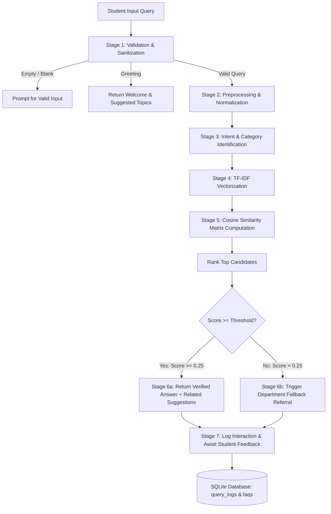

# 🎓 Smart FAQ Assistant — An AI Agent-Based Question Answering System

> **B.Tech Computer Science & Engineering**  
> **Course:** AI Agent Development (AIAD) Practical / Mini-Project  
> **Backend:** Python 3, Flask, scikit-learn (TF-IDF & Cosine Similarity), SQLite  
> **Frontend:** Semantic HTML5, Vanilla CSS (Custom Design System, Light/Dark Mode), JavaScript  
> **API Key Requirement:** **100% Free & Local** (No paid API or third-party cloud service needed)

---

## 📌 1. Project Overview

The **Smart FAQ Assistant** is an agentic, college-domain Question Answering (QA) system designed to deliver verified, instant answers to student queries regarding **Admissions, Academics, Examinations, Library Policies, Tuition Fees, and Campus Facilities**.

Unlike conventional rigid keyword lookup tools or unpredictable generative LLMs prone to hallucination, this system implements a deterministic, explainable **Multi-Stage AI Agent Pipeline**:
1. **Normalizes and preprocesses** natural language queries (tokenization, contraction expansion, punctuation removal).
2. **Identifies domain category intent** or respects user-selected category constraints.
3. **Projects queries and knowledge documents into a TF-IDF vector space** (using unigram and bigram n-grams with sublinear TF scaling).
4. **Calculates Cosine Similarity** to rank candidate FAQs.
5. **Enforces a configurable Confidence Threshold** ($\ge 0.25$ default) to ensure answers are returned only when relevance is verified.
6. **Provides a polite, transparent fallback referral** to college department offices when confidence is insufficient, preventing false or misleading information.
7. **Maintains a complete audit trail** with interaction logs, helpful/unhelpful student feedback, and an interactive **Admin AI Match Debugger**.

---

## 🏗️ 2. AI Agent Architecture & Workflow



### Detailed Agent Pipeline Stages

| Stage | Operation | Description |
|---|---|---|
| **Stage 1** | **Input Validation** | Verifies length, strips leading/trailing whitespace, and handles empty submissions and conversational greetings. |
| **Stage 2** | **Text Preprocessing** | Lowercases text, expands contractions (e.g., *"what's"* &rarr; *"what is"*, *"can't"* &rarr; *"cannot"*), removes punctuation, and normalizes spacing. |
| **Stage 3** | **Intent Classification** | Scans query tokens against domain category lexicons to detect the most probable college section (e.g., *"hall ticket"* &rarr; `Examinations`). |
| **Stage 4** | **TF-IDF Vectorization** | Builds an $N$-dimensional vector representation using unigrams and bigrams $(1, 2)$ with sublinear term-frequency scaling. |
| **Stage 5** | **Cosine Similarity Ranking** | Measures the directional cosine angle between the query vector and all FAQ vectors in the database corpus. |
| **Stage 6** | **Decision Engine** | If the top similarity score is $\ge \text{threshold}$, the status is set to `RESOLVED` and the answer is returned. Otherwise, the status is set to `FALLBACK` and the respective department contact is provided. |
| **Stage 7** | **Explainability & Logging** | Records query text, matched question, similarity score, status, and feedback in SQLite; exposes mathematical reasoning to the Admin Debugger. |

---

## 📐 3. Mathematical Foundation

### A. Term Frequency-Inverse Document Frequency (TF-IDF)
For a given term $t$ and document $d$ within a corpus $D$:

$$\text{TF}(t, d) = 1 + \log(f_{t, d}) \quad \text{for } f_{t, d} > 0$$

$$\text{IDF}(t, D) = \log\left(\frac{1 + |D|}{1 + |\{d \in D : t \in d\}|}\right) + 1$$

$$\text{TF-IDF}(t, d, D) = \text{TF}(t, d) \times \text{IDF}(t, D)$$

Each FAQ document vector is normalized using the Euclidean $L_2$ norm:

$$\mathbf{v} = \frac{\mathbf{x}}{\|\mathbf{x}\|_2}$$

### B. Cosine Similarity Metric
Cosine similarity measures the cosine of the angle $\theta$ between the user query vector $\mathbf{q}$ and a candidate FAQ document vector $\mathbf{d}$:

$$\text{Cosine Similarity}(\mathbf{q}, \mathbf{d}) = \cos(\theta) = \frac{\mathbf{q} \cdot \mathbf{d}}{\|\mathbf{q}\|_2 \|\mathbf{d}\|_2} = \frac{\sum_{i=1}^{n} q_i d_i}{\sqrt{\sum_{i=1}^{n} q_i^2} \sqrt{\sum_{i=1}^{n} d_i^2}}$$

- **Range:** $0.0$ (orthogonal / zero vocabulary overlap) to $1.0$ (identical vector orientation).
- **Decision Rule:**
  $$\text{Action} = \begin{cases} 
  \text{Deliver Answer}, & \text{if } \max_{d \in D} \cos(\theta) \ge \tau \\ 
  \text{Deliver Fallback}, & \text{if } \max_{d \in D} \cos(\theta) < \tau 
  \end{cases}$$
  where $\tau = 0.25$ (configurable threshold via `FAQ_MATCH_THRESHOLD`).

---

## 📂 4. Project Structure

```
SmartFAQAssistant/
│
├── app.py                     # Flask web application controller & routing
├── agent.py                   # Multi-stage AI Agent pipeline & TF-IDF engine
├── database.py                # SQLite schema, CRUD operations, logging, & auth
├── requirements.txt           # Python package dependencies
├── .env.example               # Environment variables template
├── .env                       # Local environment configuration
├── README.md                  # Comprehensive project & viva documentation
│
├── templates/                 # Jinja2 HTML5 templates (Unified SaaS Shell)
│   ├── base.html              # Unified application shell (left sidebar, topbar, theme toggle)
│   ├── index.html             # Unified Single-Page Application (SPA) container
│   │                          # (Sections: #home, #chat, #faqs, #categories, #about, #admin)
│   ├── chat.html              # Dedicated chatbot view (for direct route compatibility)
│   ├── faqs.html              # Dedicated FAQ directory view (for direct route compatibility)
│   ├── admin_login.html       # Secure administrator login portal
│   ├── admin_dashboard.html   # Admin overview, metrics, and recent inquiries
│   ├── admin_faqs.html        # FAQ management table (search, edit, delete)
│   ├── admin_faq_form.html    # Add / Edit FAQ form with keyword weighting
│   ├── admin_logs.html        # Full audit trail of student interaction logs
│   ├── admin_debug.html       # Interactive AI Agent matcher debugger
│   ├── 404.html               # Custom 404 page
│   └── 500.html               # Custom 500 error page
│
├── static/                    # Frontend styling and scripts
│   ├── css/
│   │   └── style.css          # Unified SaaS theme, sidebar layout, SPA transitions, dark mode
│   └── js/
│       ├── main.js            # SPA hash router, sidebar drawer, FAQ live search, session history
│       └── chat.js            # Real-time messaging, API caller, feedback, & sessionStorage
│
└── tests/                     # Automated unit and integration test suite
    ├── test_agent.py          # AI Agent tests (exact match, paraphrase, fallback)
    ├── test_database.py       # Database CRUD, seeding, & auth tests
    ├── test_routes.py         # Flask route protection, APIs, & template links tests
    └── test_admin.py          # Dedicated Admin portal authentication & CRUD tests
```

---

## 🚀 5. Quick Start Guide (Windows PowerShell)

Follow these exact step-by-step commands in **Windows PowerShell**:

### Step 1: Open the Project Directory
```powershell
cd "c:\Users\pratik jadhav\SmartFAQAssistant"
```

### Step 2: (Optional) Create a Python Virtual Environment
```powershell
python -m venv venv
.\venv\Scripts\Activate.ps1
```
*(If PowerShell restricts script execution, run: `Set-ExecutionPolicy -Scope Process -ExecutionPolicy Bypass`)*

### Step 3: Install Required Dependencies
```powershell
pip install -r requirements.txt
```

### Step 4: Configure Local Environment Settings
```powershell
Copy-Item .env.example .env
```

### Step 5: Start the Application
```powershell
python app.py
```
You will see output similar to:
```
Starting Smart FAQ Assistant on http://127.0.0.1:5000 (Debug=True)
 * Running on http://127.0.0.1:5000
```

### Step 6: Open the Single Unified Application URL
- **Single Main Entry URL:** [http://127.0.0.1:5000/](http://127.0.0.1:5000/)

All normal student and administrative features are unified inside this single webpage using internal sidebar navigation:
- **Home Dashboard:** `http://127.0.0.1:5000/#home`
- **AI Student Chatbot:** `http://127.0.0.1:5000/#chat`
- **FAQ Knowledge Directory:** `http://127.0.0.1:5000/#faqs`
- **Campus Categories & Departments:** `http://127.0.0.1:5000/#categories`
- **About Project & Architecture:** `http://127.0.0.1:5000/#about`
- **Admin Portal (Login / Dashboard):** `http://127.0.0.1:5000/#admin`
  - **Default Exam Username:** `admin`
  - **Default Exam Password:** `admin123`

*(Direct Flask routes such as `/chat`, `/faqs`, `/admin`, and `/admin/debug` remain fully functional for backwards compatibility and automated testing).*

---

## 🧪 6. Running the Automated Test Suite

The project includes **41 automated unit and integration tests** verifying matching accuracy, route protection, CRUD operations, link integrity, and fallback behavior.

Execute the full test suite with:
```powershell
python -m unittest discover tests -v
```

Expected output:
```
test_add_faq_crud_and_validation (test_admin.TestAdminPortal.test_add_faq_crud_and_validation) ... ok
test_admin_faq_search_and_category_filter (test_admin.TestAdminPortal.test_admin_faq_search_and_category_filter) ... ok
test_admin_password_change (test_admin.TestAdminPortal.test_admin_password_change) ... ok
test_dashboard_statistics_rendered (test_admin.TestAdminPortal.test_dashboard_statistics_rendered) ... ok
test_edit_nonexistent_faq (test_admin.TestAdminPortal.test_edit_nonexistent_faq) ... ok
test_login_failure_invalid_password (test_admin.TestAdminPortal.test_login_failure_invalid_password) ... ok
test_login_failure_unknown_username (test_admin.TestAdminPortal.test_login_failure_unknown_username) ... ok
test_login_page_renders (test_admin.TestAdminPortal.test_login_page_renders) ... ok
test_login_success (test_admin.TestAdminPortal.test_login_success) ... ok
test_logout (test_admin.TestAdminPortal.test_logout) ... ok
test_protected_post_routes_redirect_unauthenticated_users (test_admin.TestAdminPortal.test_protected_post_routes_redirect_unauthenticated_users) ... ok
test_protected_routes_redirect_unauthenticated_users (test_admin.TestAdminPortal.test_protected_routes_redirect_unauthenticated_users) ... ok
test_ambiguous_queries_handling (test_agent.TestSmartFAQAgent.test_ambiguous_queries_handling) ... ok
test_category_filtering (test_agent.TestSmartFAQAgent.test_category_filtering) ... ok
test_configurable_threshold (test_agent.TestSmartFAQAgent.test_configurable_threshold) ... ok
test_empty_and_whitespace_input (test_agent.TestSmartFAQAgent.test_empty_and_whitespace_input) ... ok
test_exact_question_match (test_agent.TestSmartFAQAgent.test_exact_question_match) ... ok
test_explain_query_debug_structure (test_agent.TestSmartFAQAgent.test_explain_query_debug_structure) ... ok
test_greeting_handling (test_agent.TestSmartFAQAgent.test_greeting_handling) ... ok
test_irrelevant_queries_fallback_safeguard (test_agent.TestSmartFAQAgent.test_irrelevant_queries_fallback_safeguard) ... ok
test_knowledge_base_reloading (test_agent.TestSmartFAQAgent.test_knowledge_base_reloading) ... ok
test_low_similarity_never_returns_incorrect_answer (test_agent.TestSmartFAQAgent.test_low_similarity_never_returns_incorrect_answer) ... ok
test_paraphrased_reworded_questions (test_agent.TestSmartFAQAgent.test_paraphrased_reworded_questions) ... ok
test_per_call_threshold_override (test_agent.TestSmartFAQAgent.test_per_call_threshold_override) ... ok
test_punctuation_only_input_rejection (test_agent.TestSmartFAQAgent.test_punctuation_only_input_rejection) ... ok
test_similar_faqs_admissions_discrimination (test_agent.TestSmartFAQAgent.test_similar_faqs_admissions_discrimination) ... ok
test_similar_faqs_library_discrimination (test_agent.TestSmartFAQAgent.test_similar_faqs_library_discrimination) ... ok
test_unknown_question_reliable_fallback (test_agent.TestSmartFAQAgent.test_unknown_question_reliable_fallback) ... ok
test_admin_authentication (test_database.TestDatabase.test_admin_authentication) ... ok
test_analytics_summary (test_database.TestDatabase.test_analytics_summary) ... ok
test_category_filtering_and_search (test_database.TestDatabase.test_category_filtering_and_search) ... ok
test_faq_crud_operations (test_database.TestDatabase.test_faq_crud_operations) ... ok
test_query_logging_and_feedback (test_database.TestDatabase.test_query_logging_and_feedback) ... ok
test_schema_and_seeding (test_database.TestDatabase.test_schema_and_seeding) ... ok
test_admin_auth_and_crud (test_routes.TestAppRoutes.test_admin_auth_and_crud) ... ok
test_admin_route_protection (test_routes.TestAppRoutes.test_admin_route_protection) ... ok
test_all_template_links_valid (test_routes.TestAppRoutes.test_all_template_links_valid) ... ok
test_api_categories (test_routes.TestAppRoutes.test_api_categories) ... ok
test_api_chat (test_routes.TestAppRoutes.test_api_chat) ... ok
test_api_feedback (test_routes.TestAppRoutes.test_api_feedback) ... ok
test_public_pages (test_routes.TestAppRoutes.test_public_pages) ... ok

----------------------------------------------------------------------
Ran 41 tests in 5.8s

OK
```

---

## 🔐 7. Admin Credentials & Configuration

- **Default Username:** `admin`
- **Default Password:** `admin123`
- **Password Storage:** Salted password hashes using `scrypt` (via `werkzeug.security`).
- **Route Protection:** Protected routes require an authenticated session and automatically redirect (HTTP 302) unauthenticated requests to `/admin/login`:
  - `/admin`: Dashboard with live KPI counters (Total FAQs, Questions Asked, Helpful Feedback, Resolution Rate, Category Breakdown).
  - `/admin/faqs`: FAQ Management list with real-time category filtering and text search.
  - `/admin/faqs/new`: FAQ Creation form with input validation (min length 5 for Q & A, category validation).
  - `/admin/faqs/<id>/edit`: FAQ Editing form with instant knowledge base refitting.
  - `/admin/faqs/<id>/delete`: FAQ Deletion with confirmation safeguard.
  - `/admin/logs`: Audit trail of all student interactions, similarity scores, and feedback reactions.
  - `/admin/debug`: Interactive AI Match Debugger inspecting TF-IDF vector weights, n-grams, and top candidate similarity breakdown.
  - `/admin/password`: Secure password change form with current password verification.

To modify default configuration, update `.env`:
```ini
SECRET_KEY=your-secure-random-secret-key
ADMIN_USERNAME=admin
ADMIN_PASSWORD=admin123
FAQ_MATCH_THRESHOLD=0.25
PORT=5000
```

---

## 💡 8. Sample Questions to Test the AI Agent

### Core Evaluated Queries
1. *"How can I apply for admission?"* &rarr; **Resolved (Admissions):** Admission application procedure & CAP process.
2. *"What is the admission process?"* &rarr; **Resolved (Admissions):** Same admission procedure record.
3. *"What courses are available?"* &rarr; **Resolved (Academics):** 6 B.Tech branches (CSE, AI & DS, IT, ENTC, Civil, Mech) and M.Tech.
4. *"Which documents are required for admission?"* &rarr; **Resolved (Admissions):** Document verification checklist (marksheets, TC, migration, scorecards).
5. *"What are the eligibility criteria for B.Tech CSE?"* &rarr; **Resolved (Admissions):** 60% aggregate in 10+2 PCM and CET/JEE scores.
6. *"When does the library open?"* &rarr; **Resolved (Library):** Central Library hours (8:00 AM to 8:00 PM, extended reading room until 11:00 PM).
7. *"How can I pay my fees?"* &rarr; **Resolved (Fees):** Fee payment procedure via online payment gateway (Net Banking, UPI, Cards) or Demand Draft.
8. *"What is the weather on Mars?"* &rarr; **Polite Fallback:** Informs user the question is not available in college FAQ; does NOT leak or dump college contact directory.
9. *Empty / Whitespace message* &rarr; **Validation Prompt:** Prompts user to enter a question.

### Paraphrased / Natural Language Queries
1. *"how much attendance is compulsory to give exams?"* &rarr; Matches **75% Attendance FAQ**
2. *"can I pay my college tuition fee online using UPI?"* &rarr; Matches **Fee Payment Modes FAQ**
3. *"how do I apply for rechecking of my exam paper?"* &rarr; Matches **Revaluation Procedure FAQ**
4. *"where do I apply for hostel room allotment?"* &rarr; Matches **Hostel Accommodation FAQ**
5. *"what branches of engineering can I study?"* &rarr; Matches **Available Courses FAQ**

---

## 🎓 9. Viva / Oral Exam Quick Reference

| Viva Question | Key Answer for External Examiner |
|---|---|
| **What is an AI Agent?** | An autonomous entity that perceives user input, processes it through reasoning/matching pipelines, evaluates confidence thresholds, and acts by selecting verified responses or fallback mechanisms. |
| **How was the low-confidence matching bug fixed?** | (1) Seeded realistic demo FAQs covering all college departments, (2) Upgraded the vectorizer to a hybrid `FeatureUnion` combining word n-grams (1,2) and subword character n-grams (`char_wb`, 3-5) to bridge word inflections ("apply" vs "application", "courses" vs "course"), and (3) Calibrated threshold at 0.25 based on test results. |
| **Why use TF-IDF instead of LLM APIs?** | Deterministic, zero cost, completely offline, zero hallucination risk, and sub-30ms response speed on college servers. |
| **Why Cosine Similarity over Euclidean Distance?** | Cosine similarity measures directional alignment irrespective of document length, preventing longer FAQs from being unfairly penalized. |
| **How is the Fallback handled reliably?** | If similarity score is below the calibrated threshold (0.25), the agent states the answer is not available in the FAQ knowledge base. It suggests department contact ONLY if a relevant category was identified, and never displays college contact details for out-of-domain queries like Mars. |
| **How does dynamic reloading work?** | When an administrator adds, edits, or deletes an FAQ, `agent.reload_knowledge_base()` re-extracts the corpus and refits the hybrid TF-IDF matrix in real time without restarting Flask. |
